# Dairy, Agriculture & Finance ERP Platform

A comprehensive Enterprise Resource Planning (ERP) system designed for integrated management of dairy operations, agricultural fields, inventory, and financial tracking.


## 📖 Table of Contents
- [System Architecture](#-system-architecture)
- [ERP Diagram](#-erp-entity-relationship-diagram)
- [Modules Overview](#-modules-overview)
- [Tech Stack](#-tech-stack)
- [Getting Started](#-getting-started)
- [Installation](#-installation)
- [Database Setup](#-database-setup)
- [Running the Application](#-running-the-application)
- [API Documentation](#-api-documentation)

---

## 🏗 System Architecture

The application follows a modular monolith architecture with a clear separation of concerns:

1.  **Frontend (SPA)**: Built with React and Vite, it communicates with the backend via RESTful APIs. It handles the UI/UX, state management (TanStack Query/Zustand), and presentation logic.
2.  **Backend (API)**: Built with NestJS, it serves as the core logic layer. It handles authentication, data validation, business rules, and communicates with the database.
3.  **Database**: PostgreSQL serves as the relational data store, ensuring data integrity with foreign keys, constraints, and triggers.

### Data Flow & Integration
The core innovation of this platform is the **Centralized Finance Engine**.
*   **Dairy Module**: Milk production logs automatically trigger income transactions in Finance.
*   **Agriculture Module**: Harvests generate income, while planting expenses (seeds, fertilizers) generate expense transactions.
*   **Inventory Module**: Purchase orders create payable entries, and stock consumption updates cost centers.
*   **Analytics**: Aggregates data from all modules to provide real-time P&L, balance sheets, and operational KPIs.

---

## 📊 ERP Entity-Relationship Diagram

The following diagram visualizes the database schema and relationships between modules.

```mermaid
erDiagram
    %% ======================================================================================
    %% 🔐 AUTHENTICATION MODULE
    %% Manages system access and user roles
    %% ======================================================================================
    AUTH_USERS {
        uuid id PK "System ID"
        string username UK "Unique Login ID"
        string email UK "Unique Email Address"
        string password_hash "Bcrypt Encrypted"
        string full_name "Display Name"
        enum role "ADMIN|FINANCE|DAIRY|AGRI|WAREHOUSE|SALES|PLANNING|VIEWER"
        boolean is_active "Default: true"
        timestamp last_login "Nullable"
        timestamp created_at "Audit"
        timestamp updated_at "Audit"
    }

    %% ======================================================================================
    %% 🌍 MASTER DATA MANAGEMENT (MDM)
    %% Core reference data used across all modules
    %% ======================================================================================
    MDM_VENDORS {
        uuid id PK
        string vendor_code UK "Unique Identifier"
        string vendor_name "Legal Name"
        string vendor_type "SUPPLIER | CONTRACTOR (Nullable)"
        string contact_person "Nullable"
        string phone "Nullable"
        string email "Nullable"
        string address "Nullable"
        string city "Nullable"
        string state "Nullable"
        string pincode "Nullable"
        string payment_terms "Nullable"
        boolean is_active
        timestamp created_at
        timestamp updated_at
        uuid created_by FK "Nullable - Link to User"
    }
    MDM_CUSTOMERS {
        uuid id PK
        string customer_code UK
        string customer_name
        string customer_type "B2B | RETAIL | DISTRIBUTOR | BULK (Nullable)"
        string contact_person "Nullable"
        string phone "Nullable"
        string email "Nullable"
        string address "Nullable"
        string city "Nullable"
        string state "Nullable"
        string pincode "Nullable"
        decimal credit_limit "Default: 0"
        string payment_terms "Nullable"
        boolean is_active
        timestamp created_at
        timestamp updated_at
        uuid created_by FK "Nullable"
    }
    MDM_COST_CENTERS {
        uuid id PK
        string cost_center_code UK
        string cost_center_name
        string description "Nullable"
        boolean is_active
        timestamp created_at
        timestamp updated_at
        uuid created_by FK "Nullable"
    }
    MDM_PRODUCTS {
        uuid id PK
        string product_code UK
        string product_name
        uuid category_id FK "Nullable - Link to Category"
        string description "Nullable"
        string unit_of_measure "Nullable"
        boolean is_raw_material "Default: false"
        boolean is_finished_good "Default: false"
        boolean is_active
        timestamp created_at
        timestamp updated_at
        uuid created_by FK "Nullable"
    }
    WAREHOUSE_LOCATIONS {
        uuid id PK
        string code UK "Unique Location ID"
        string name "Location Name"
        enum type "WAREHOUSE|ZONE|RACK|BIN|TANK|SILO"
        string description "Nullable"
        uuid parent_id FK "Nullable - Recursive Parent"
        boolean is_active
        decimal capacity "Nullable"
        string capacity_unit "Nullable"
        timestamp created_at
        timestamp updated_at
    }

    %% ======================================================================================
    %% 🐄 DAIRY MODULE
    %% Tracks herd management and milk production
    %% ======================================================================================
    DAIRY_COWS {
        uuid id PK
        string cow_tag_number UK "Ear Tag ID"
        string cow_name
        string breed
        date date_of_birth
        date purchase_date "Nullable"
        decimal purchase_price "Default: 0"
        decimal current_value "Default: 0"
        enum gender "FEMALE | MALE"
        enum status "ACTIVE|SOLD|DEAD|DRY|PREGNANT|LACTATING"
        uuid vendor_id FK "Nullable - Purchased From"
        uuid location_id FK "Nullable - Current Housing"
        uuid cost_center_id FK "Nullable - Expense Tracking"
        uuid asset_id FK "Nullable - Fixed Asset Ref"
        uuid parent_cow_id FK "Nullable - Mother"
        boolean is_active
        timestamp created_at
        timestamp updated_at
        uuid created_by FK "Nullable"
    }
    DAIRY_MILK_PRODUCTION {
        uuid id PK
        uuid cow_id FK
        date production_date
        enum session "MORNING | AFTERNOON | EVENING"
        decimal quantity_liters
        decimal fat_percentage "Nullable"
        decimal snf_percentage "Nullable"
        enum quality_grade "A | B | C (Nullable)"
        string notes "Nullable"
        timestamp created_at
        uuid created_by FK "Nullable"
    }
    DAIRY_HEALTH_RECORDS {
        uuid id PK
        uuid cow_id FK
        date checkup_date
        string diagnosis
        string treatment "Nullable"
        string veterinarian "Nullable"
        decimal cost "Nullable"
        date next_checkup_date "Nullable"
        string notes "Nullable"
        timestamp created_at
        timestamp updated_at
        uuid created_by FK "Nullable"
    }
    DAIRY_BREEDING_RECORDS {
        uuid id PK
        uuid cow_id FK
        enum event_type "INSEMINATION|PREGNANCY_CHECK|CALVING|ABORTION"
        date event_date
        string details "Nullable"
        uuid bull_id FK "Nullable - Sire"
        string technician "Nullable"
        decimal cost "Nullable"
        date expected_calving_date "Nullable"
        string notes "Nullable"
        timestamp created_at
        timestamp updated_at
        uuid created_by FK "Nullable"
    }

    %% ======================================================================================
    %% 🌾 AGRICULTURE MODULE
    %% Field management, planting, and harvesting
    %% ======================================================================================
    AGRI_FIELDS {
        uuid id PK
        string field_name
        string field_code UK
        decimal area_size
        string area_unit "Default: acres"
        string location "Nullable"
        string gps_coordinates "Nullable"
        string soil_type "Nullable"
        string irrigation_type "Nullable"
        boolean is_active
        timestamp created_at
        timestamp updated_at
    }
    AGRI_PLANTINGS {
        uuid id PK
        uuid field_id FK
        uuid crop_id FK
        date planting_date
        date expected_harvest_date "Nullable"
        decimal area_planted "Nullable"
        decimal seed_quantity "Nullable"
        string seed_unit "Nullable"
        string planting_method "Nullable"
        uuid cost_center_id FK "Nullable"
        string status "Default: ACTIVE"
        string notes "Nullable"
        timestamp created_at
        timestamp updated_at
    }
    AGRI_HARVESTS {
        uuid id PK
        uuid planting_id FK
        date harvest_date
        decimal quantity_harvested
        string quantity_unit
        string quality_grade "Nullable"
        decimal market_price "Nullable"
        decimal total_value "Nullable"
        string storage_location "Nullable"
        uuid product_id FK "Nullable - Link to MDM"
        uuid transaction_id FK "Nullable - Link to Finance"
        string notes "Nullable"
        timestamp created_at
        timestamp updated_at
        uuid created_by FK "Nullable"
    }

    %% ======================================================================================
    %% 📦 INVENTORY & WAREHOUSE MODULE
    %% Stock tracking, movements, and procurement
    %% ======================================================================================
    INVENTORY_ITEMS {
        uuid id PK
        string item_code UK
        string item_name
        string category "Nullable"
        string unit_of_measure
        decimal reorder_level "Default: 0"
        decimal reorder_quantity "Default: 0"
        decimal unit_cost "Default: 0"
        string description "Nullable"
        boolean is_active
        timestamp created_at
        timestamp updated_at
    }
    INVENTORY_STOCK {
        uuid id PK
        uuid item_id FK
        string location "Default: Main Warehouse"
        decimal quantity_on_hand "Default: 0"
        decimal quantity_reserved "Default: 0"
        decimal quantity_available "Default: 0"
        timestamp last_updated
    }
    INVENTORY_MOVEMENTS {
        uuid id PK
        uuid item_id FK
        string movement_type "IN | OUT"
        timestamp movement_date
        decimal quantity
        string location "Nullable"
        string reference_type "Nullable (e.g. Purchase)"
        uuid reference_id "Nullable"
        decimal cost_per_unit "Nullable"
        decimal total_value "Nullable"
        string notes "Nullable"
        uuid created_by FK "Nullable"
        timestamp created_at
    }
    PURCHASE_ORDERS {
        uuid id PK
        string po_number UK
        uuid vendor_id FK "Nullable"
        date order_date
        date expected_delivery_date "Nullable"
        string status "Default: DRAFT"
        decimal subtotal "Default: 0"
        decimal tax_amount "Default: 0"
        decimal total_amount "Default: 0"
        string notes "Nullable"
        uuid created_by FK "Nullable"
        uuid approved_by FK "Nullable"
        timestamp approved_at "Nullable"
        timestamp created_at
        timestamp updated_at
    }
    STOCK_TRANSFERS {
        uuid id PK
        string transfer_number UK
        uuid item_id FK
        uuid from_location_id FK "Nullable"
        uuid to_location_id FK
        decimal quantity
        enum status "PENDING|COMPLETED|CANCELLED"
        uuid transferred_by FK "Nullable"
        string notes "Nullable"
        timestamp transferred_at "Nullable"
        timestamp created_at
    }

    %% ======================================================================================
    %% 🏭 PROCESSING MODULE
    %% Recipe management and batch production
    %% ======================================================================================
    PROCESSING_RECIPES {
        uuid id PK
        string name
        string code UK
        string description "Nullable"
        uuid output_item_id FK "Finished Good"
        decimal expected_yield
        string yield_unit
        boolean is_active
        timestamp created_at
        timestamp updated_at
    }
    PROCESSING_RECIPE_INPUTS {
        uuid id PK
        uuid recipe_id FK
        uuid item_id FK "Raw Material"
        decimal quantity
        string unit
    }
    PROCESSING_BATCHES {
        uuid id PK
        string batch_number UK
        uuid recipe_id FK
        enum status "PLANNED|IN_PROGRESS|COMPLETED|CANCELLED"
        timestamp start_time "Nullable"
        timestamp end_time "Nullable"
        decimal actual_yield "Nullable"
        uuid managed_by FK "Nullable"
        string notes "Nullable"
        timestamp created_at
        timestamp updated_at
    }

    %% ======================================================================================
    %% 💰 FINANCE MODULE (CENTRAL ENGINE)
    %% Double-entry bookkeeping and budgeting
    %% ======================================================================================
    FIN_ACCOUNTS {
        uuid id PK
        string account_code UK
        string account_name
        enum type "ASSET|LIABILITY|EQUITY|INCOME|EXPENSE"
        string description "Nullable"
        boolean is_active
        timestamp created_at
        timestamp updated_at
        uuid created_by FK "Nullable"
    }
    FIN_TRANSACTIONS {
        uuid id PK
        string transaction_code UK
        date transaction_date
        uuid transaction_group_id FK
        uuid category_id FK
        uuid subcategory_id FK "Nullable"
        uuid account_id FK
        uuid cost_center_id FK "Nullable"
        uuid operation_unit_id FK "Nullable"
        decimal amount
        string description "Nullable"
        string reference_type "Nullable"
        uuid reference_id "Nullable"
        string payment_method "Nullable"
        uuid vendor_id FK "Nullable"
        uuid customer_id FK "Nullable"
        string notes "Nullable"
        boolean is_active
        timestamp created_at
        timestamp updated_at
        uuid created_by FK "Nullable"
        uuid updated_by FK "Nullable"
    }
    FIN_BUDGETS {
        uuid id PK
        string budget_code UK
        string budget_name
        enum budget_period "MONTHLY|QUARTERLY|YEARLY"
        date start_date
        date end_date
        uuid budget_group_id FK "Nullable"
        uuid cost_center_id FK "Nullable"
        decimal total_budget_amount "Default: 0"
        decimal total_actual_amount "Default: 0"
        enum status "DRAFT|ACTIVE|CLOSED"
        string notes "Nullable"
        boolean is_active
        timestamp created_at
        timestamp updated_at
        uuid created_by FK "Nullable"
    }

    %% ======================================================================================
    %% 🔗 RELATIONSHIPS & DATA FLOW
    %% ======================================================================================

    %% --- USER ACCESS ---
    AUTH_USERS ||--o{ FIN_TRANSACTIONS : "Authorizes"
    AUTH_USERS ||--o{ PURCHASE_ORDERS : "Creates/Approves"
    AUTH_USERS ||--o{ STOCK_TRANSFERS : "Executes"
    AUTH_USERS ||--o{ DAIRY_MILK_PRODUCTION : "Logs"
    AUTH_USERS ||--o{ INVENTORY_MOVEMENTS : "Records"

    %% --- MDM LINKS ---
    WAREHOUSE_LOCATIONS ||--o{ WAREHOUSE_LOCATIONS : "Parent-Child Hierarchy"
    MDM_VENDORS ||--o{ PURCHASE_ORDERS : "Supplies"
    MDM_VENDORS ||--o{ FIN_TRANSACTIONS : "Payee"
    MDM_CUSTOMERS ||--o{ FIN_TRANSACTIONS : "Payer"
    MDM_VENDORS ||--o{ DAIRY_COWS : "Supplied"
    MDM_COST_CENTERS ||--o{ FIN_TRANSACTIONS : "Tracks Cost"
    MDM_COST_CENTERS ||--o{ DAIRY_COWS : "Assigned To"
    MDM_COST_CENTERS ||--o{ AGRI_PLANTINGS : "Assigned To"
    MDM_COST_CENTERS ||--o{ FIN_BUDGETS : "Budget Owner"

    %% --- DAIRY FLOW ---
    WAREHOUSE_LOCATIONS ||--o{ DAIRY_COWS : "Houses"
    DAIRY_COWS ||--o{ DAIRY_COWS : "Parent-Calf"
    DAIRY_COWS ||--o{ DAIRY_MILK_PRODUCTION : "Produces"
    DAIRY_COWS ||--o{ DAIRY_HEALTH_RECORDS : "Has"
    DAIRY_COWS ||--o{ DAIRY_BREEDING_RECORDS : "Has"

    %% --- AGRICULTURE FLOW ---
    AGRI_FIELDS ||--o{ AGRI_PLANTINGS : "Grows"
    AGRI_PLANTINGS ||--o{ AGRI_HARVESTS : "Yields"
    MDM_PRODUCTS ||--o{ AGRI_HARVESTS : "Product Ref"
    AGRI_HARVESTS ||--o{ FIN_TRANSACTIONS : "Generates INCOME"

    %% --- INVENTORY FLOW ---
    INVENTORY_ITEMS ||--o{ INVENTORY_STOCK : "Maintains Stock"
    INVENTORY_ITEMS ||--o{ INVENTORY_MOVEMENTS : "Tracks Flow"
    INVENTORY_ITEMS ||--o{ PURCHASE_ORDERS : "Line Item"
    INVENTORY_ITEMS ||--o{ STOCK_TRANSFERS : "Transfer Utility"
    WAREHOUSE_LOCATIONS ||--o{ STOCK_TRANSFERS : "Source/Dest"
    WAREHOUSE_LOCATIONS ||--o{ AGRI_HARVESTS : "Stores Yield"

    %% --- PROCESSING FLOW ---
    INVENTORY_ITEMS ||--o{ PROCESSING_RECIPES : "Output Finished Good"
    INVENTORY_ITEMS ||--o{ PROCESSING_RECIPE_INPUTS : "Input Raw Material"
    PROCESSING_RECIPES ||--o{ PROCESSING_RECIPE_INPUTS : "Consists of"
    PROCESSING_RECIPES ||--o{ PROCESSING_BATCHES : "Defines Process"
    AUTH_USERS ||--o{ PROCESSING_BATCHES : "Manages"

    %% --- FINANCE FLOW ---
    FIN_ACCOUNTS ||--o{ FIN_TRANSACTIONS : "Ledger Entry"
    PURCHASE_ORDERS ||--o{ FIN_TRANSACTIONS : "Generates EXPENSE"
```



---

## 📦 Modules Overview

### 1. Finance Engine 💰
*   **Chart of Accounts**: Manage assets, liabilities, equity, income, and expenses.
*   **Transactions**: Double-entry bookkeeping with automatic tagging.
*   **Budgeting**: Set and track budgets against actuals (Monthly/Quarterly/Yearly).
*   **Reports**: P&L, Balance Sheet, Cash Flow.

### 2. Dairy Operations 🥛
*   **Herd Management**: Track cows, calves, and bulls.
*   **Milk Production**: Daily logs per cow/session with quality grading (Fat/SNF).
*   **Health & Breeding**: Vaccination schedules, insemination tracking, and calving prediction.

### 3. Agriculture Management 🌾
*   **Field Mapping**: Manage plots with GPS coordinates and soil types.
*   **Crop Lifecycle**: Track from planting to harvest.
*   **Harvests**: Record yields and grade quality.

### 4. Inventory Management 📦
*   **Stock Control**: Real-time stock levels across multiple locations.
*   **Procurement**: Purchase Order (PO) workflow creation and approval.
*   **Movements**: Track usage (Feed, Seeds, Fertilizers) and transfers.

---

## 🛠 Tech Stack

### Backend
*   **Framework**: NestJS (Node.js)
*   **Database**: PostgreSQL 15+
*   **ORM**: TypeORM
*   **Authentication**: Passport JWT & Bcrypt
*   **Documentation**: Swagger API

### Frontend
*   **Framework**: React 18
*   **Build Tool**: Vite
*   **Styling**: Tailwind CSS
*   **State Management**: Zustand & TanStack Query
*   **Charts**: Recharts

---

## 🚀 Getting Started

### Prerequisites
*   Node.js (v18+)
*   PostgreSQL (v14+)
*   npm or yarn

### Installation

#### 1. Clone the Repository
```bash
git clone <repository-url>
cd DAIRY_AGRI_APPLICATION
```

#### 2. Backend Setup
```bash
cd backend
npm install
```

#### 3. Frontend Setup
```bash
cd ../frontend
npm install
```

---

## 🗄 Database Setup

1.  Create a PostgreSQL database named `dairy_agri_db`.
2.  Navigate to the `backend/database` folder.
3.  Run the schema scripts in the following order:

```bash
# 1. Base Schema (Auth, MDM, Finance)
psql -d dairy_agri_db -f schema.sql

# 2. Dairy Module
psql -d dairy_agri_db -f schema_dairy.sql

# 3. Agriculture Module
psql -d dairy_agri_db -f schema_agriculture.sql

# 4. Inventory Module
psql -d dairy_agri_db -f schema_inventory.sql
```

> **Note**: The schemas include seed data for an Admin user and default settings.

---

## ▶️ Running the Application

### Start Backend
```bash
cd backend
# Development mode
npm run start:dev

# Production mode
npm run build
npm run start:prod
```
*   Server runs on: `http://localhost:3000`
*   Swagger Docs: `http://localhost:3000/api`

### Start Frontend
```bash
cd frontend
npm run dev
```
*   App runs on: `http://localhost:5173`

### Default Credentials
*   **Username**: `admin`
*   **Password**: `admin123`

---

## 📚 API Documentation

The backend includes a fully documented Swagger UI. Once the backend is running, visit:
**`http://localhost:3000/api`**

Use this interface to test endpoints for:
*   `/auth`: Login and registration.
*   `/finance`: Transactions, accounts, budgets.
*   `/dairy`: Cows, milk production, events.
*   `/agriculture`: Fields, plantings, harvests.
*   `/inventory`: Stock, items, purchase orders.
